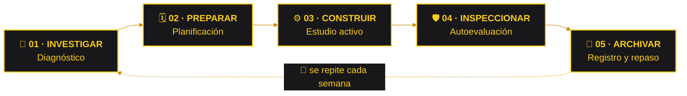
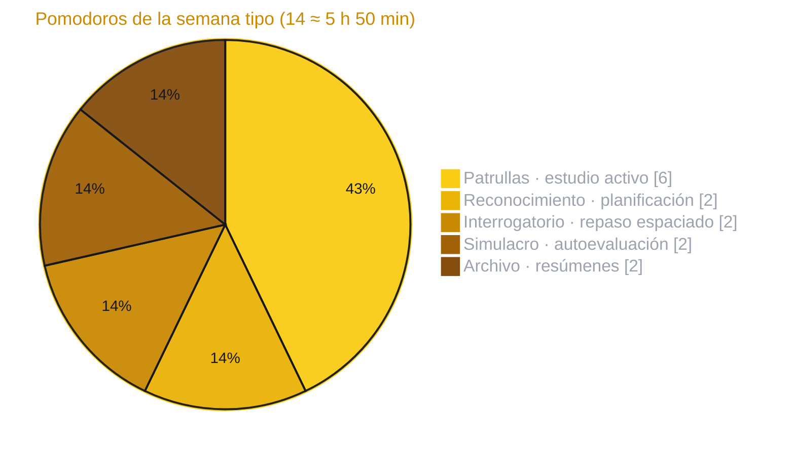

<a name="inicio"></a>

<h1 align="center">Plan de Estudio para Estudiantes</h1>

<p align="center">
  <strong>🦇 LA BATICUEVA DEL CONOCIMIENTO · GOTHAM STUDY DIVISION</strong><br>
  <em>Gotham tiene villanos. Nosotros tenemos un plan.</em>
</p>

<div align="center">


<h2>🦇 EL PLAN QUE GOTHAM NECESITA</h2>


**La noche es larga. El plan tiene que ser claro.**


<br>


<br><br>

**Bienvenidos a la Baticueva, nuestro centro de operaciones académicas.**<br>
Aquí convertimos el caos de tareas, exámenes y horarios en un plan de ataque.<br>
Investigamos cómo aprendemos, organizamos el tiempo y vigilamos cada avance.

**Cinco mentes. Un plan. Cero excusas.**

[🌃 Expediente](#-el-expediente--de-qué-trata-este-repositorio) ·
[🦇 Batfamilia](#-la-batfamilia--integrantes-y-roles) ·
[🔎 Protocolo](#-protocolo-de-la-baticueva--las-5-fases) ·
[🧰 Batcinturón](#-el-batcinturón--técnicas-de-estudio) ·
[🌙 Ronda semanal](#-la-ronda-nocturna--plan-semanal) ·
[🚨 Batímetro](#-batímetro--niveles-de-alerta) ·
[🃏 Villanos](#-galería-de-villanos-del-estudio) ·
[🐙 Git](#-protocolo-git-de-la-baticueva) ·
[☕ Descanso](#-zona-de-descanso--alfred-sirve-el-café)

</div>

---

## 🌃 El expediente · ¿De qué trata este repositorio?

Este repositorio guarda nuestro **plan de estudio para estudiantes**: una guía práctica para organizar el tiempo, estudiar con métodos que sí funcionan y llegar a los exámenes con la cabeza fría (y no después de una noche entera sin dormir).

Como en cualquier investigación de Gotham, primero reunimos pistas: qué materias hay, cuánto tiempo tenemos y qué temas cuestan más. Después trazamos la ruta, la ponemos en marcha, comprobamos si funcionó y dejamos todo registrado en el repositorio para la siguiente ronda.

<div align="center">

</div>

### 🎯 Objetivos de la misión

- **Organizar el tiempo** con un horario realista que se pueda cumplir semana tras semana.
- **Estudiar con técnicas comprobadas**, como la recuperación activa, el repaso espaciado y el método Pomodoro.
- **Detectar a tiempo los temas débiles** mediante simulacros y autoevaluaciones.
- **Registrar el progreso** en el repositorio para ajustar el plan con datos y no con corazonadas.
- **Cuidar el descanso**, porque un cerebro sin dormir no resuelve ningún caso.

> [!TIP]
> **Lema del equipo:** «Si lo puedes planear, lo puedes aprender».
>
> Batman nunca sale a patrullar sin un plan. Nosotros tampoco entramos a un examen sin uno.

## 🦇 La Batfamilia · Integrantes y roles

Todo gran plan necesita un equipo que lo sostenga. Cada integrante tiene un rol dentro del protocolo, pero todos estudiamos, todos preguntamos y todos revisamos.

<div align="center">

</div>

| N.º | BatIntegrante | BatOperaciones | BatObjetivo |
| :---: | :--- | :--- | :--- |
| **1** | **Paredes Acosta Dereck Shair** | **Detective del Código Oscuro · Investigar · Analista** | Reunir las pistas iniciales: materias, temas, fechas de evaluación, tiempo disponible y puntos débiles. |
| **2** | **Ashanga Yumbo Brishy Anahy** | **Arquitecto de la Baticueva Digital · Preparar · Diseñar** | Diseñar el horario semanal: ordenar los temas por prioridad, repartir los bloques de estudio y reservar tiempo para repasar y descansar. |
| **3** | **Calderon Carvajal Fher Dorian** | **Caballero del Backend · Construir · Programar** | Convertir el diseño en sesiones concretas: ejercicios, prácticas y material listo para trabajar cada día. |
| **4** | **Casillas Ochoa Antony Sebastian** | **Guardián Nocturno del Testing · Inspeccionar · Probar** | Comprobar lo aprendido con simulacros, preguntas de práctica y autoevaluaciones antes de que llegue el examen real. |
| **5** | **Sanchez Bastidas Karina Paola** | **Oráculo del Conocimiento · Archivar · Documentar** | Registrar avances, resúmenes y lecciones aprendidas para que el plan mejore cada semana. |

**La mejor herramienta de la Baticueva sigue siendo trabajar juntos.**

## 🔎 Protocolo de la Baticueva · Las 5 fases

Cada semana el plan pasa por las mismas cinco fases. Igual que en una investigación, ninguna pista se descarta y ningún caso se cierra sin pruebas.



| Fase | Operación | Qué hacemos | Evidencia del caso |
| :---: | :--- | :--- | :--- |
| **01** | **Investigar · Diagnosticar** | Listamos materias y temas, anotamos fechas de exámenes y entregas, medimos el tiempo libre real y hacemos una autoevaluación inicial. | Mapa de la situación: qué hay que estudiar, para cuándo y desde qué nivel partimos. |
| **02** | **Preparar · Planificar** | Priorizamos según urgencia y dificultad, repartimos bloques de estudio en la semana y reservamos espacios para repaso y descanso. | Horario semanal: nuestra ruta de patrullaje. |
| **03** | **Construir · Estudiar** | Cumplimos los bloques con estudio activo: resolver ejercicios, explicar en voz alta, programar sin copiar y armar apuntes propios. | Ejercicios resueltos, apuntes y dudas anotadas. |
| **04** | **Inspeccionar · Evaluar** | Hacemos simulacros con tiempo, corregimos con la solución en mano y anotamos cada error en una bitácora. | Resultado del simulacro y bitácora de errores. |
| **05** | **Archivar · Registrar** | Resumimos lo aprendido, actualizamos el progreso y ajustamos el plan para la semana siguiente. | Reporte semanal y plan actualizado. |

> [!IMPORTANT]
> **Regla de la Baticueva:** ningún tema se da por aprendido solo porque «ya lo leí».

## 🧰 El Batcinturón · Técnicas de estudio

Batman no carga cualquier cosa en su cinturón, solo lo que funciona. Estas son las herramientas que usamos en cada ronda.

| Gadget | Técnica | Cómo se usa | Ideal para |
| :--- | :--- | :--- | :--- |
| 🪃 **Batarang Pomodoro** | Técnica Pomodoro | 25 minutos de concentración total y 5 de descanso. Cada cuatro rondas, un descanso largo de 15 a 30 minutos. | Arrancar cuando la procrastinación ataca. |
| 🧠 **Batgancho de la memoria** | Recuperación activa | Cerrar el cuaderno y escribir todo lo que recuerdas del tema; después comparar con los apuntes y corregir. | Teoría, definiciones y conceptos. |
| 📅 **Calendario de patrullaje** | Repaso espaciado | Volver al mismo tema varias veces, con intervalos cada vez más largos (por ejemplo, a 1, 3, 7 y 14 días). | Recordar a largo plazo y no solo hasta el examen. |
| 🎙️ **Método Alfred** | Técnica Feynman | Explicar el tema con palabras sencillas, como si se lo enseñaras a alguien que nunca lo vio. Donde te trabas, ahí está la laguna. | Entender en lugar de memorizar. |
| 🔀 **Rotación de patrullas** | Práctica intercalada | Mezclar distintos tipos de ejercicios en una misma sesión en vez de repetir siempre el mismo. | Matemáticas, física y programación. |
| 🗺️ **Mapa de Gotham** | Mapas mentales | Conectar los conceptos de un tema en un esquema visual con ramas y relaciones. | Ver el panorama completo de una unidad. |
| 💻 **Planos antes que código** | Pseudocódigo y diagramas de flujo | Escribir el algoritmo en pasos o dibujar el diagrama antes de programar. | Materias de programación. |
| 🛌 **Protocolo de recarga** | Descanso y sueño | Dormir entre 7 y 9 horas y hacer pausas de verdad: el sueño ayuda a fijar lo aprendido. | Todas las misiones, sin excepción. |

## 🌙 La ronda nocturna · Plan semanal

Una propuesta base para adaptarla al horario de cada estudiante. Lo importante no es estudiar más horas, sino estudiar todos los días con un objetivo claro.

| Día | Misión | Actividad principal | Duración sugerida |
| :--- | :--- | :--- | :---: |
| **Lunes** | 🔎 Reconocimiento | Revisar pendientes y fechas de la semana; ajustar el horario. | 30 min + 2 🍅 |
| **Martes** | 🦇 Patrulla A | Tema difícil n.º 1 con recuperación activa. | 3 🍅 |
| **Miércoles** | 🦇 Patrulla B | Ejercicios mixtos con práctica intercalada. | 3 🍅 |
| **Jueves** | 🧠 Interrogatorio | Repaso espaciado de lo visto y preguntas de práctica. | 2 🍅 |
| **Viernes** | 🛡️ Simulacro | Miniexamen con tiempo y corrección inmediata. | 2 🍅 |
| **Sábado** | 📜 Archivo | Resúmenes, mapa mental y actualización del progreso. | 2 🍅 |
| **Domingo** | ☕ Recarga en la mansión | Descanso. Gotham también se cuida descansando. | Libre |

> 🍅 = un Pomodoro de 25 minutos.



<details>
<summary><b>⏱️ Estructura de una sesión · Patrullaje estándar (≈ 2 horas)</b></summary>

<br>

```text
00:00  Calentamiento ...... repasar lo de ayer sin mirar (5 min)
00:05  Pomodoro 1 ......... tema nuevo, celular fuera de alcance (25 min)
00:30  Descanso ........... agua y estirarse (5 min)
00:35  Pomodoro 2 ......... ejercicios sin ver la solución (25 min)
01:00  Descanso ........... (5 min)
01:05  Pomodoro 3 ......... recuperación activa: escribir lo que recuerdo (25 min)
01:30  Descanso ........... (5 min)
01:35  Pomodoro 4 ......... corregir errores y anotarlos en la bitácora (25 min)
02:00  Cierre ............. marcar el avance y elegir la misión de mañana
```

</details>

## 🚨 Batímetro · Niveles de alerta

Para saber cuándo encender la Batseñal antes de que sea demasiado tarde.

> [!TIP]
> 🟢 **Gotham en calma:** vas al día con los bloques y los repasos. Mantén el ritmo y repasa lo de la semana.

> [!NOTE]
> 🔵 **Actividad sospechosa:** hay uno o dos temas atrasados o un simulacro con nota baja. Reorganiza el horario y refuerza primero esos temas.

> [!WARNING]
> 🟠 **Alerta en Gotham:** falta menos de una semana para el examen y hay temas sin ver. Prioriza lo que más pesa en la nota y pide ayuda al equipo o al docente.

> [!CAUTION]
> 🔴 **¡Batseñal encendida!** El examen es en 48 horas y la lista de pendientes no baja. Simulacros enfocados, repaso de lo esencial y a dormir igual (sí, igual).

### ✅ Checklist de la misión

- [ ] Lista de materias, temas y fechas de evaluación · *Detective*
- [ ] Horario semanal con bloques de estudio, repaso y descanso · *Arquitecto*
- [ ] Banco de ejercicios y material por tema · *Caballero*
- [ ] Primer simulacro y bitácora de errores · *Guardián*
- [ ] Reporte semanal del progreso · *Oráculo*

## 🃏 Galería de villanos del estudio

*Clasificación humorística de los enemigos que aparecen en cualquier semana de exámenes.*

| Villano | Su versión en el estudio | Señal de alerta | Cómo derrotarlo |
| :--- | :--- | :--- | :--- |
| **El Joker** | La procrastinación, que convierte cualquier horario en caos. | «Lo hago mañana». | Empezar con un solo Pomodoro: lo difícil es arrancar. |
| **Hiedra Venenosa** | Las redes sociales y su scroll infinito que te enreda. | «Solo un video más». | Celular en otra habitación o en modo avión durante el bloque. |
| **El Pingüino** | La falsa productividad: decorar apuntes y ordenar el escritorio en lugar de estudiar. | Pasaste una hora eligiendo colores para subrayar. | Medir el avance en ejercicios resueltos, no en apuntes bonitos. |
| **El Acertijo** | Las dudas que se acumulan sin resolver. | «No entendí esto, pero sigo». | Anotar cada duda y llevarla a clase, a tutoría o al equipo. |
| **Dos Caras** | La multitarea: estudiar mientras ves una serie. | Leíste tres páginas y no recuerdas ninguna. | Una tarea a la vez; la serie queda como premio al final. |
| **El Espantapájaros** | La ansiedad antes del examen. | Miedo de abrir el cuaderno. | Simulacros previos y respiración: la práctica le quita poder al miedo. |
| **Bane** | El agotamiento por estudiar toda la noche. | «Si no duermo, me alcanza el tiempo». | Sesiones cortas y espaciadas; dormir también es parte del plan. |
| **Mr. Freeze** | La mente en blanco durante la prueba. | Sabías la respuesta… ayer. | Practicar recuperación activa: sacar la información, no solo leerla. |
| **Clayface** | Memorizar sin entender: parece conocimiento, pero es barro. | Sabes la definición, pero no puedes explicarla. | Técnica Feynman y ejercicios de aplicación. |

## 🐙 Protocolo Git de la Baticueva

Así trabajamos el repositorio para que ningún avance se pierda en las alcantarillas de Gotham.

### 🧭 Mapa de la Baticueva

Estructura sugerida del repositorio, con una carpeta por fase del protocolo:

```text
📦 Plan-de-Estudio
 ┣ 📂 01-diagnostico    → Detective: materias, temas, fechas y autoevaluación inicial
 ┣ 📂 02-horario        → Arquitecto: horario semanal y prioridades
 ┣ 📂 03-sesiones       → Caballero: ejercicios, prácticas y apuntes por tema
 ┣ 📂 04-simulacros     → Guardián: simulacros y bitácora de errores
 ┣ 📂 05-bitacora       → Oráculo: reportes semanales y lecciones aprendidas
 ┗ 📜 README.md         → este expediente
```

### 🌿 Ramas por agente

| Agente | Rama de trabajo | Ejemplo de commit |
| :--- | :--- | :--- |
| 🔎 Detective del Código Oscuro | `detective/<tema>` | `docs: agrega el diagnóstico de la semana 1` |
| 📐 Arquitecto de la Baticueva Digital | `arquitecto/<tema>` | `docs: crea el horario de la semana 1` |
| ⚙️ Caballero del Backend | `caballero/<tema>` | `feat: agrega el banco de ejercicios del tema 2` |
| 🛡️ Guardián Nocturno del Testing | `guardian/<tema>` | `test: agrega el simulacro 1 con su solucionario` |
| 📜 Oráculo del Conocimiento | `oraculo/<tema>` | `docs: registra el reporte de la semana 1` |

### 🚀 La misión en cuatro pasos

```bash
# 1. Clonar la Baticueva (solo la primera vez)
git clone https://github.com/USUARIO/REPOSITORIO.git
cd REPOSITORIO

# 2. Crear la rama del agente
git checkout -b arquitecto/horario-semana-1

# 3. Guardar el avance con un mensaje claro
git add .
git commit -m "docs: crea el horario de la semana 1"

# 4. Subir la rama a GitHub
git push -u origin arquitecto/horario-semana-1
```

Después se abre un **Pull Request** hacia `main`. El Guardián Nocturno lo revisa y, si todo está en orden, se fusiona.

| Prefijo | Cuándo usarlo |
| :--- | :--- |
| `docs:` | Apuntes, horarios, reportes y cambios en el README. |
| `feat:` | Material nuevo: ejercicios, plantillas o recursos. |
| `fix:` | Corregir errores en apuntes, ejercicios o soluciones. |
| `test:` | Simulacros, cuestionarios y autoevaluaciones. |

> [!TIP]
> Antes de cada sesión, `git pull` para traer lo último de la Baticueva. Cada duda se registra como **Issue** con la etiqueta `acertijo` y se cierra cuando alguien del equipo la resuelve.

> [!CAUTION]
> Nada llega a `main` sin revisión. Ni siquiera Batman hace *push* directo.

## ⚡ Código de conducta

- **Investigar antes de estudiar.** Saber qué entra en el examen ahorra horas.
- **Planear sin rigidez.** Un buen plan se ajusta cuando cambia la ronda.
- **Poco, pero todos los días.** La constancia le gana al maratón de última hora.
- **Practicar, no solo leer.** Resolver ejercicios es entrenar en la Baticueva.
- **Preguntar sin miedo.** Hasta Batman consulta a Oráculo.
- **Dejar pistas útiles.** Apuntes y commits claros para tu yo del futuro y para el equipo.
- **Descansar también es entrenar.** El sueño es parte del plan, no un premio.
- **Aprender de los fallos.** Cada error del simulacro es una pista, no una derrota.

## 📜 El juramento de la Baticueva

> *«En la noche más larga y ante el examen más difícil,*<br>
> *ningún tema quedará sin repasar.*<br>
> *Planearé antes de actuar, practicaré antes de confiar*<br>
> *y dormiré antes de la batalla.*<br>
> *Por Gotham, por el equipo… y por el promedio».*

## ☕ Zona de descanso · Alfred sirve el café

Hasta el Caballero Oscuro necesita una pausa entre Pomodoros. Un pequeño descanso antes de volver al expediente.

<details>
<summary><b>🦇 Batman, ¿cuál es tu verdadero superpoder?</b></summary>

<br>

**Estudiar 25 minutos seguidos sin revisar el celular.**

Ni toda la fortuna de Wayne Enterprises puede comprar esa concentración.

</details>

<details>
<summary><b>🤵 Un consejo de Alfred</b></summary>

<br>

—Señor, debería dormir antes del examen.

—Alfred, Gotham me necesita despierto.

**A la mañana siguiente, Batman no recordaba ni su contraseña.**

Esa noche nació una nueva regla: el sueño también guarda los cambios.

</details>

<details>
<summary><b>🃏 El plan del Joker</b></summary>

<br>

—Batman, te dejé un regalito en tu horario.

—¿Qué hiciste?

—Moví todos tus temas al domingo en la noche.

—¿Y qué esperas que pase?

—Ja, ja, ja… ¡que te diviertas el lunes!

**Siguiente misión:** repartir los temas durante toda la semana.

</details>

<details>
<summary><b>❓ El Acertijo deja una pista</b></summary>

<br>

*«Mientras más me usas, más fuerte me vuelvo;*<br>
*si me abandonas, poco a poco me desvanezco.*<br>
*¿Qué soy?»*

Batman revisa sus tarjetas de repaso.

**Respuesta:** la memoria.

Por eso existe el repaso espaciado. Alfred ya había preparado las tarjetas… y tres cafés.

</details>

<details>
<summary><b>💻 La Baticomputadora tiene una objeción</b></summary>

<br>

—Ya me lo sé, no necesito repasar.

—Señor, según la bitácora, usted falló esa pregunta tres veces.

Batman decide hacer un simulacro.

**Clayface queda descartado por el momento.**

</details>

<details>
<summary><b>🔀 El Joker y el merge</b></summary>

<br>

—Batman, hice *push* directo a `main`.

—¿Sin Pull Request?

—Sin Pull Request, sin revisión y con un conflicto de *merge* de regalo.

**El Guardián Nocturno ya está revirtiendo el commit.**

</details>

<details>
<summary><b>🚨 Se encendió la Batseñal</b></summary>

<br>

Las frases que la activan:

- «Mañana empiezo».
- «Eso no viene en el examen».
- «Solo un capítulo más de la serie».
- «Ya lo leí, entonces ya me lo sé».
- «¿El examen era hoy?».

**Primero revisamos el plan. Después buscamos al villano.**

</details>

---

<div align="center">


🦇

*No hace falta una capa para aprobar.*<br>
*Hace falta un plan, constancia y volver a intentarlo.*

**La próxima respuesta puede estar en ese tema que todavía no repasaste.**

<sub>Un plan con estrategia, trabajo en equipo y espíritu de detective.</sub>

<br>

[⬆️ Volver a la Baticueva](#inicio)


</div>
